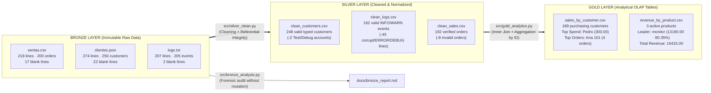
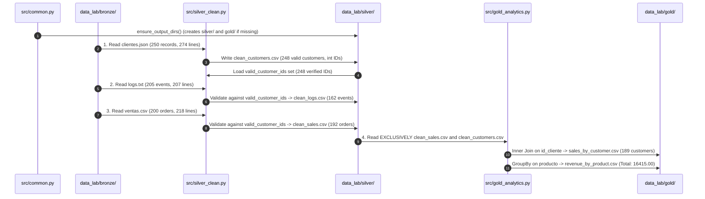
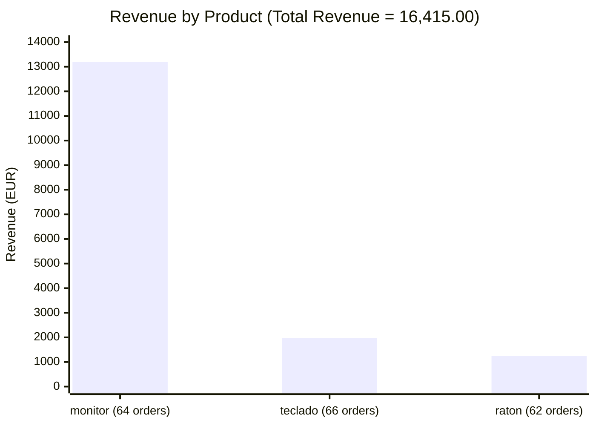

#  Datacycle Mini Lakehouse — From Raw Data to Business Intelligence


-D4AF37?style=for-the-badge)


> **Stucom Pelai · DAW 2 · Datacycle (Unit 2 · Academic Year 2026-27)**  
> **Assignment:** *Activity 3 – Building a Mini Lakehouse*  
> An end-to-end Python data engineering pipeline that transforms **655 raw, noisy records** across three heterogeneous file formats (`CSV`, `JSON`, and `TXT`) into verified analytical business tables following the **Medallion Architecture**, without a single manual file edit.

---

<a id="table-of-contents"></a>
##  Table of Contents

1. [The Story Behind the Data: Why a Lakehouse?](#1-story-behind-the-data)
2. [Medallion Architecture and Pipeline Flow](#2-medallion-architecture)
3. [Bronze Layer: Forensic Audit of Raw Data](#3-bronze-layer)
4. [Silver Layer: Cleaning, Typing, and Referential Integrity Engine](#4-silver-layer)
5. [Gold Layer: OLAP Analytics and Business Insights](#5-gold-layer)
6. [Direct Answers to All Lab Questions (PDF Prompt)](#6-direct-answers)
7. [Code Engineering (`src/`) and Formal Data Contracts](#7-code-engineering)
8. [Step-by-Step Execution Guide](#8-execution-guide)
9. [Complete Repository Structure](#9-repository-structure)
10. [Team, Git Workflow, and AI Traceability](#10-team-and-ai)
11. [Documentation and Deliverables](#11-deliverables)

---

<a id="1-story-behind-the-data"></a>
##  1. The Story Behind the Data: Why a Lakehouse?

Imagine the business department receives three freshly exported files from separate systems (`ventas.csv`, `clientes.json`, and `logs.txt`) and asks two seemingly simple questions:

1. **"Who is our top customer?"**
2. **"What is our total revenue, and which product drives the most sales?"**

If an analyst queries the raw files directly without a multi-layer data engineering pipeline, **every single conclusion will be wrong**:

| Failure When Querying Raw Data Directly (No Lakehouse) | Reality Discovered After Auditing and Cleaning the Pipeline |
|---|---|
|  **The "top customer" appears to be `Debug` (`id=201`) with `9999.00`** | `201 Debug` is a synthetic debugging account that injected an artificial order (`id_pedido=30`, `monitor`, `9999`) more than **33x higher** than the real maximum price (`300.00`). |
|  **Grouping customers by `nombre` ranks `Ana` #1 in spend with `320.00`** | The customer master contains **two different people named `Ana`**: `id_cliente=101` (`290.00` across 4 orders) and `id_cliente=111` (`30.00` in 1 order). Grouping properly by primary key (`id_cliente`) reveals that the true top buyer by total spend is **Pedro (`id_cliente=106`) with `300.00`**. |
|  **Strict joins drop legitimate purchases from customer `120` (`Eva`)** | Her `id_cliente` is serialized in JSON as a string (`"120"`) instead of an integer (`120`). Without type normalization, her `210.00` purchase is lost during the join. |
|  **Phantom, negative, and corrupt transactions pollute revenue** | The raw sales file contains a phantom customer (`999` with `150.00`), an order without a customer (`id_pedido=15`), a negative price (`-10`), a string price (`abc`), and a fake product `test` priced at `0.00`. |
|  **Real customers get deleted for having `[ERROR]` entries in `logs.txt`** | 31 real customers experienced a technical application error (`[ERROR]`) in the logs, yet they are valid customers with legitimate orders. Cleaning logs must **never** delete valid entities from the customer dimension. |

To solve these challenges in a deterministic, reproducible, and auditable way, we built this **Mini Lakehouse** following the **Medallion Architecture (Bronze -> Silver -> Gold)**.

---

<a id="2-medallion-architecture"></a>
##  2. Medallion Architecture and Pipeline Flow

The pipeline separates the data lifecycle into three decoupled storage layers with strict quality boundaries:



###  Execution Sequence and Referential Integrity

The internal execution order guarantees that no downstream table ever contains orphan foreign keys:



> [!NOTE]
> **File Naming Equivalence (PDF Prompt vs. Delivered ZIP Dataset):**  
> The activity PDF refers generically to `sales.csv` and `customers.json`, whereas the official dataset delivered in the ZIP archive contains **`ventas.csv`**, **`clientes.json`**, and **`logs.txt`**. Respecting Bronze layer immutability, the pipeline processes the original filenames inside `data_lab/bronze/` without manual renaming or editing.

---

<a id="3-bronze-layer"></a>
##  3. Bronze Layer: Forensic Audit of Raw Data

The **Bronze Layer** (`data_lab/bronze/`) preserves the raw source files untouched. To inspect them without mutating a single byte, we engineered [`src/bronze_analysis.py`](src/bronze_analysis.py), a pure-Python forensic scanner that parses every line and cross-references primary and foreign keys in memory.

### 3.1 Inventory and Structure of Bronze Files

| File | Format / Structure | Size | Total Lines | Blank Lines | Raw Records | Detected Schema / Fields |
|---|---|---:|---:|---:|---:|---|
|  [`data_lab/bronze/ventas.csv`](data_lab/bronze/ventas.csv) | Tabular CSV (comma-delimited) | `3,897 B` | `218` | `17` | **200 orders** | `id_pedido,id_cliente,producto,importe` |
|  [`data_lab/bronze/clientes.json`](data_lab/bronze/clientes.json) | JSON (array of objects) | `12,599 B` | `274` | `22` | **250 customers** | `id_cliente`, `nombre`, `pais` |
|  [`data_lab/bronze/logs.txt`](data_lab/bronze/logs.txt) | Plain text (`[LEVEL] key=value`) | `6,109 B` | `207` | `2` | **205 events** | `[NIVEL] user=<id> action=<accion>` |

---

### 3.2 Complete Map of Anomalies Detected in Bronze

####  A. Anomalies in `ventas.csv` (218 lines -> 200 data rows)

1. **17 interleaved blank lines:** appear every 10 orders starting at line 32 (`lines 32, 43, 54, 65, 76, 87, 98, 109, 120, 131, 142, 153, 164, 175, 186, 197, and 208`). A naive line-by-line CSV parser without blank-line filtering will raise an `IndexError` or insert null rows.
2. **8 invalid or non-commercial orders** that would corrupt financial reporting:

| CSV Line | `id_pedido` | `id_cliente` | `producto` | `importe` | Anomaly Category | Business Impact if Unfiltered |
|---:|---:|---:|---|---|---|
| `6` | `5` | `999` | `monitor` | `150` | **Orphan customer ID** (`999` does not exist in `clientes.json`) | Unattributable sale; causes product total vs. customer total mismatch |
| `7` | `6` | `104` | `raton` | `-10` | **Negative amount** (`< 0`) | Illegitimately subtracts revenue from `raton` and customer `104` |
| `8` | `7` | `105` | `teclado` | `abc` | **Non-numeric amount** (`string`) | Breaks float casting or corrupts numeric aggregation |
| `16` | `15` | `""` *(empty)* | `raton` | `20` | **Missing `id_cliente`** (empty field) | Cannot be joined to any buyer in the customer dimension |
| `30` | `29` | `200` | `test` | `0` | **Test product + Zero amount + `TestUser`** | Introduces a fake fourth product (`test`) with `0.00` revenue |
| `31` | `30` | `201` | `monitor` | `9999` | **Artificial outlier + `Debug` account** | Inflates `monitor` revenue by `+9999.00` (+75%) and crowns `Debug` #1 |
| `116` | `107` | `200` | `teclado` | `30` | **Sale linked to synthetic `TestUser` account** | Pollutes real commercial metrics with test traffic |
| `117` | `108` | `201` | `raton` | `20` | **Sale linked to synthetic `Debug` account** | Pollutes real commercial metrics with debug traffic |

3. **Orders with identical payload but distinct `id_pedido` (Critical Domain Case Study):**
   - Orders **`1`** (line 2), **`31`** (line 33), and **`32`** (line 34) share `(id_cliente=101, producto=teclado, importe=30)`.
   - **Are they corrupt duplicates?** **No.** In a transactional schema without a `quantity` column, each single-unit purchase generates a new unique primary key (`id_pedido = 1, 31, 32`). Because `id_pedido` is unique, these represent **three legitimate repeat purchases** of a keyboard by `101 Ana` (who also bought a `200.00` monitor in order `3`, totaling 4 orders and `290.00`).

---

####  B. Anomalies in `clientes.json` (274 lines -> 250 JSON objects)

1. **22 interleaved blank lines** inside the JSON array.
2. **Data type inconsistency:** record `id_cliente="120"` (`Eva`, `ES`) stores its ID as a `string` rather than an `int`.
3. **Missing fields or invalid placeholders (`"??"` / `null`):**
   - `id_cliente=112` -> `nombre: ""` (empty string), `pais: "ES"`.
   - `id_cliente=117` -> `nombre: "Raul"`, `pais: null`.
   - `id_cliente=138` -> `nombre: "user8"`, `pais: "??"`.
4. **Non-productive synthetic accounts:**
   - `id_cliente=200` -> `nombre: "TestUser"`, `pais: "??"`.
   - `id_cliente=201` -> `nombre: "Debug"`, `pais: "ES"`.
5. **Homonymous customers (same name, distinct entity):**
   - `id_cliente=101` (`nombre: "Ana"`, `pais: "ES"`) and `id_cliente=111` (`nombre: "Ana"`, `pais: "ES"`).
6. **Valid generic customer names:** 218 customers are named `user1` through `user218` (IDs `131–199` and `202–350`), representing valid accounts with real purchases.
7. **Raw country distribution:** `ES` (`226`), `FR` (`6`), `IT` (`5`), `PT` (`4`), `DE` (`4`), `UK` (`2`), `??` (`2`), `null` (`1`).

---

####  C. Anomalies in `logs.txt` (207 lines -> 205 events)

- **Log level distribution:** `INFO` (`135`), `ERROR` (`35`), `WARN` (`31`), `DEBUG` (`4`).
- **Action distribution (across non-empty action lines):** `login` (`84`), `compra` (`61`), `logout` (`54`), `test` (`4`).
- **Breakdown of the 45 defective or non-operational lines:**
  - **2 blank lines:** lines `155` and `186`.
  - **35 `[ERROR]` events:** include non-numeric users (`user=abc` on line `15`, `user=xyz` on line `124`), an orphan user (`user=999` on lines `4` and `27`), and 31 error events affecting real customers (`[102, 107, 114, 119, 128, 134, 141, 149, ...]`).
  - **4 `[DEBUG]` events:** lines `25, 105, 106, and 107` with `action=test` (users `122, 201, 202, 203`).
  - **1 line missing the `user=` key:** line `22` (`[INFO] action=compra`).
  - **2 lines with an empty `action=` value:** line `23` (`[INFO] user=120 action=`) and line `117` (`[INFO] user=213 action=`).
  - **1 `[INFO]` event from a test account:** line `104` (`[INFO] user=200 action=login`, belonging to `TestUser`).

---

<a id="4-silver-layer"></a>
##  4. Silver Layer: Cleaning, Typing, and Referential Integrity Engine

[`src/silver_clean.py`](src/silver_clean.py) executes the **Bronze -> Silver** transformation in three deterministic phases. It never modifies files in Bronze and regenerates `data_lab/silver/*.csv` from scratch on every run.

### 4.1 Bronze -> Silver Transformation Balance

| Phase | Function in `src/silver_clean.py` | Input (Bronze) | Output (Silver) | Input Records | Dropped | Clean Output | Retention Rate |
|:---:|---|---|---|---:|---:|---:|---:|
| **1st** | `clean_customers()` | `bronze/clientes.json` | [`silver/clean_customers.csv`](data_lab/silver/clean_customers.csv) | `250` *(274 lines)* | **2** | **248 customers** | `99.20%` |
| **2nd** | `clean_logs()` | `bronze/logs.txt` | [`silver/clean_logs.csv`](data_lab/silver/clean_logs.csv) | `205` *(207 lines)* | **45** *(of 207 lines)* | **162 events** | `79.02%` |
| **3rd** | `clean_sales()` | `bronze/ventas.csv` | [`silver/clean_sales.csv`](data_lab/silver/clean_sales.csv) | `200` *(218 lines)* | **8** | **192 orders** | `96.00%` |

---

### 4.2 Business Rules and Engineering Decisions in Silver

####  Phase 1: `clean_customers.csv` (`id_cliente,nombre,pais`)
1. **Blank-line tolerance & strict integer casting:** parses the full JSON array (skipping all 22 blank lines) and converts `id_cliente` to `int > 0` (recovering `"120"` -> `120,Eva,ES`).
2. **Semantic imputation (`"desconocido"`):** rather than deleting real customers who are missing a descriptive attribute (which would destroy their valid sales in Gold), missing, `null`, or `"??"` values are standardized to `"desconocido"`:
   - `112` (`nombre=""`) -> `112,desconocido,ES` (preserves their `210.00` order).
   - `117` (`pais=null`) -> `117,Raul,desconocido` (preserves their `200.00` order).
   - `138` (`pais="??"`) -> `138,user8,desconocido` (preserves their `200.00` order).
3. **ISO country standardization:** converts valid country codes to uppercase (`ES`, `FR`, `IT`, `PT`, `DE`, `UK`).
4. **Synthetic account removal (`2 dropped`):** filters out `200 TestUser` and `201 Debug` by both ID and name (`cuenta_test_o_debug: 2`).
5. **Primary-key deduplication (`id_cliente`):** enforces uniqueness on `id_cliente` without deduplicating on `nombre`, preserving both `101,Ana,ES` and `111,Ana,ES`.

####  Phase 2: `clean_logs.csv` (`nivel,id_cliente,action`)
1. **Operational noise filtering:** drops the `2` blank lines, all `35` `[ERROR]` events, and all `4` `[DEBUG]` events, retaining only valid operational activity (`INFO` and `WARN`).
2. **Structural & referential validation:** drops line `22` (`sin_user: 1`), lines `23` and `117` (`action_vacio: 2`), and line `104` belonging to `200 TestUser` (`user_inexistente_o_test: 1`), validating every `user` against the **248 verified IDs in `clean_customers.csv`**.
3. **Golden rule:** the **31 real customers** who experienced an `[ERROR]` event in `logs.txt` **remain untouched in `clean_customers.csv`**.

####  Phase 3: `clean_sales.csv` (`id_pedido,id_cliente,producto,importe`)
1. **Structural cleanup:** skips all `17` interleaved blank lines and normalizes column headers.
2. **Audited removal of the 8 invalid orders:**
   - `id_cliente_vacio_o_invalido: 1` (order `15`).
   - `producto_test: 1` (order `29`, `producto=test, importe=0`).
   - `importe_no_numerico_o_no_positivo: 2` (order `6` with `-10` and order `7` with `abc`).
   - `importe_outlier_debug: 1` (order `30` with `importe=9999` from `201 Debug`, exceeding `MAX_VALID_AMOUNT = 1000.0`).
   - `id_cliente_inexistente_o_test: 3` (order `5` with `id_cliente=999`, order `107` from `200 TestUser`, and order `108` from `201 Debug`).
3. **Normalization & deterministic ordering:** `producto` normalized to lowercase (`monitor`, `teclado`, `raton`), `importe` cast to `float` rounded to 2 decimal places, and rows sorted by `id_pedido` ascending.

---

<a id="5-gold-layer"></a>
##  5. Gold Layer: OLAP Analytics and Business Insights

[`src/gold_analytics.py`](src/gold_analytics.py) enforces the core rule of the Medallion Architecture: **it reads exclusively from `data_lab/silver/`** (`clean_sales.csv` and `clean_customers.csv`) using `pandas`, producing the final business tables in `data_lab/gold/`.

### 5.1  Customer Sales Ranking (`data_lab/gold/sales_by_customer.csv`)

An `INNER JOIN` on `id_cliente` combines the **192 clean orders** with the **248 valid customers**, grouping by `(id_cliente, nombre, pais)` and sorting by `total_sales` descending. In total, **189 distinct customers** placed at least one order (the remaining 59 customers in Silver have 0 purchases):

| Rank | `id_cliente` | `nombre` | `pais` | `num_pedidos` | `total_sales` | % of Total | Key Business Highlight / Observation |
|:---:|---:|---|---|---:|---:|---:|---|
| **1st** | **`106`** | **Pedro** | `PT` | `1` | **`300.00`** | `1.83%` | **Top Buyer by Total Spend (`Total Sales`)** — Order `#8` (`monitor`) |
| **2nd** | **`101`** | **Ana** | `ES` | **`4`** | **`290.00`** | `1.77%` | **Top Buyer by Order Frequency (4 orders)** — `1 monitor (200)` + `3 teclados (3x30)` |
| **3rd** | **`109`** | **Elena** | `FR` | `1` | **`220.00`** | `1.34%` | `monitor` purchase (`id_pedido=11`) |
| **4th** | `112` | `desconocido` | `ES` | `1` | `210.00` | `1.28%` | Customer with `nombre=""` in Bronze, imputed in Silver (`id_pedido=14`) |
| **5th** | `120` | `Eva` | `ES` | `1` | `210.00` | `1.28%` | Customer with `id_cliente="120"` (`str`) in Bronze, cast to `int` in Silver |
| **6th – 33rd** | `127..265` | *(28 customers)* | `ES / IT` | `1` *(each)* | `210.00` *(each)* | `35.82%` | 30 total customers tied at `210.00` (`monitor` units at `210.00`) |
| **34th – 62nd** | `117..268` | *(29 customers)* | `Mixed` | `1` *(each)* | `200.00` *(each)* | `35.33%` | Includes `117 Raul` and `138 user8` (`pais=desconocido`) |
| **63rd** | `102` | `Luis` | `FR` | `1` | `180.00` | `1.10%` | `monitor` purchase (`id_pedido=2`) |
| **64th** | `123` | `Carlos` | `PT` | `1` | `170.00` | `1.04%` | `monitor` purchase (`id_pedido=26`) |
| **65th – 127th** | `108..269` | **Ana (`111`) & 62 others** | `Mixed` | `1` *(each)* | `30.00` *(each)* | `11.51%` | Includes **`111 Ana` (`ES`, 1 order, `30.00`)**, kept separate from `101 Ana` |
| **128th – 189th** | `103..270` | *(62 customers)* | `Mixed` | `1` *(each)* | `20.00–25.00` | `7.71%` | `raton` buyers (`3` at `25.00` and `59` at `20.00`) |
| **TOTAL** | **189 customers** | — | — | **192 orders** | **`16415.00`** | **`100.00%`** | **Exact match with `revenue_by_product.csv`** |

---

### 5.2  Revenue by Product (`data_lab/gold/revenue_by_product.csv`)

Aggregating `clean_sales.csv` by `producto` and ordering by `total_revenue` descending:

| Rank | `producto` | `num_pedidos` | % of Orders | `total_revenue` | % of Revenue (`Share`) | Average Order Value (`AOV`) | Unit Price Range |
|:---:|---|---:|---:|---:|---:|---:|---:|
| **1st** | **`monitor`** | `64` | `33.33%` | **`13190.00`** | **`80.35%`** | `206.09` | `170.00 – 300.00` |
| **2nd** | **`teclado`** | **`66`** *(1st in units)* | `34.38%` | **`1980.00`** | **`12.06%`** | `30.00` | `30.00` *(fixed price)* |
| **3rd** | **`raton`** | `62` | `32.29%` | **`1245.00`** | **`7.58%`** | `20.08` | `20.00 – 25.00` |
| **TOTAL** | **3 products** | **192 orders** | **`100.00%`** | **`16415.00`** | **`100.00%`** | **`85.49`** | `20.00 – 300.00` |



> [!IMPORTANT]
> **Key Business Insight (Volume vs. Value):**  
> Even though all three products have an almost identical order volume (~33% each, with **`teclado`** leading in unit sales at **66 orders** vs. **64** for `monitor`), **`monitor` generates 80.35% of total company revenue (`13190.00` out of `16415.00`)** because its average ticket (`206.09`) is nearly 7x higher than `teclado` (`30.00`) and 10x higher than `raton` (`20.08`).

---

<a id="6-direct-answers"></a>
##  6. Direct Answers to All Lab Questions (PDF Prompt)

This section provides direct, concise answers to every question in the assignment specification (*Activity 3 – Building a Mini Lakehouse*):

<details open>
<summary><b>Part 1 Questions (Bronze Layer)</b></summary>

1. **What file type is each source file and what structure does it have?**
   - `ventas.csv`: comma-delimited tabular CSV file (`3,897 B`, 218 lines, 17 blank lines, 200 records) with columns `id_pedido,id_cliente,producto,importe`.
   - `clientes.json`: semi-structured JSON array of objects (`12,599 B`, 274 lines, 22 blank lines, 250 records) with keys `id_cliente`, `nombre`, `pais`.
   - `logs.txt`: plain-text key-value event log prefixed by severity tag (`6,109 B`, 207 lines, 2 blank lines, 205 events) formatted as `[NIVEL] user=<id> action=<accion>`.
2. **Which data is unreliable?**
   - Corrupt or artificial amounts in `ventas.csv`: `-10` (order `6`), `abc` (order `7`), `0` on `producto=test` (order `29`), and the `9999` outlier from `201 Debug` (order `30`).
   - Sales without a valid real customer: order `15` (empty `id_cliente`), order `5` (non-existent `id_cliente=999`), and orders `29, 30, 107, 108` tied to synthetic accounts `200 TestUser` and `201 Debug`.
   - `[ERROR]` (35) and `[DEBUG]` (4) events in `logs.txt`, as well as `"??"` country placeholders in `clientes.json`.
3. **What information is missing?**
   - **Record-level missing data:** `id_cliente` in order `15`; `nombre` in customer `112`; `pais` in customer `117` (`null`) and customers `138` and `200` (`"??"`); `user=` field on line `22` of `logs.txt`; `action=` value on lines `23` and `117` of `logs.txt`.
   - **Data-model-level missing data:** absence of timestamps (`date`/`time`) in both `ventas.csv` and `logs.txt`, and absence of a product master catalog or item `quantity` column.
</details>

<details open>
<summary><b>Part 2 Questions (Silver Layer)</b></summary>

1. **Which records are invalid and were discarded?**
   - **In `ventas.csv` (8 discarded out of 200 -> 192 kept):** orders `5` (orphan customer `999`), `6` (`importe=-10`), `7` (`importe=abc`), `15` (empty `id_cliente`), `29` (`producto=test`, `importe=0`, `TestUser`), `30` (`importe=9999`, `Debug`), `107` (`TestUser`), and `108` (`Debug`), plus 17 blank lines.
   - **In `clientes.json` (2 discarded out of 250 -> 248 kept):** synthetic accounts `200 TestUser` and `201 Debug`, plus 22 blank lines.
   - **In `logs.txt` (45 lines discarded out of 207 -> 162 events kept):** 2 blank lines, 35 `[ERROR]` lines, 4 `[DEBUG]` lines, 1 line missing `user=` (line 22), 2 lines with empty `action=` (lines 23 and 117), and 1 event from `user=200` (`TestUser`, line 104).
2. **Which customers have incomplete information and how were they handled?**
   - `id_cliente=112` (`nombre=""`) -> normalized to `112,desconocido,ES`.
   - `id_cliente=117` (`nombre="Raul"`, `pais=null`) -> normalized to `117,Raul,desconocido`.
   - `id_cliente=138` (`nombre="user8"`, `pais="??"`) -> normalized to `138,user8,desconocido`.
   - `id_cliente="120"` (`nombre="Eva"`, `pais="ES"`, string ID) -> cast to integer `120,Eva,ES`.
   - `id_cliente=200` (`nombre="TestUser"`, `pais="??"`) -> excluded as a synthetic test account.
</details>

<details open>
<summary><b>Part 3 Questions (Gold Layer)</b></summary>

1. **Who is the top buyer / which customer generates the most revenue?**
   - **By total revenue generated (total spend):** **Pedro** (`id_cliente=106`, `pais=PT`) with **`300.00`** in 1 order (`id_pedido=8`, `monitor`).
   - **By number of orders placed (frequency):** **Ana** (`id_cliente=101`, `pais=ES`) with **4 orders** (`id_pedido=1, 3, 31, 32`) and **`290.00`** total spend (`111 Ana` is a distinct customer with 1 order and `30.00`).
2. **Which product generates the most revenue?**
   - **`monitor`**, generating **`13190.00`** across 64 orders (**80.35%** of the **`16415.00`** total global revenue), followed by `teclado` (`1980.00` across 66 orders, 12.06%) and `raton` (`1245.00` across 62 orders, 7.58%).
</details>

---

<a id="7-code-engineering"></a>
##  7. Code Engineering (`src/`) and Formal Data Contracts

All source code lives under [`src/`](src/) and adheres to three software engineering principles:
- **Cross-platform portability (`pathlib.Path`):** runs identically on Windows, macOS, and Linux whether invoked via `python src/script.py` or `python -m src.script`.
- **Minimal dependencies:** `common.py`, `bronze_analysis.py`, and `silver_clean.py` rely solely on the Python Standard Library (`csv`, `json`, `re`, `pathlib`, `collections`, `math`); `gold_analytics.py` uses `pandas` for relational joins and OLAP aggregations.
- **Automated quality assertions (`assert`):** the Gold script programmatically verifies that `test` products and the `9999` debug outlier are absent, and checks that total revenue by customer matches total revenue by product to the cent (`16415.00`).

### 7.1 Modules in `src/`

| Module | Lines | Dependencies | Core Functions & Responsibility |
|---|---:|---|---|
| [`src/common.py`](src/common.py) | `72` | Stdlib (`pathlib`) | Defines `BASE_DIR`, `DATA_DIR`, `BRONZE_DIR`, `SILVER_DIR`, `GOLD_DIR`, `DOCS_DIR`, `ensure_dir()`, `ensure_output_dirs()`, and `verify_project_structure()`. |
| [`src/bronze_analysis.py`](src/bronze_analysis.py) | `459` | Stdlib (`csv`, `json`, `re`) | `analyze_customers()`, `analyze_sales()`, `analyze_logs()`, and `print_report()`. Audits raw files and outputs exact line numbers for every anomaly. |
| [`src/silver_clean.py`](src/silver_clean.py) | `530` | Stdlib (`csv`, `json`, `re`, `math`) | `clean_customers()`, `load_valid_customer_ids()`, `clean_logs()`, `clean_sales()`, and `main()`. Cleans, normalizes types, and enforces referential integrity. |
| [`src/gold_analytics.py`](src/gold_analytics.py) | `132` | `pandas` | `find_col()` and `main()`. Reads from `data_lab/silver/`, executes `inner join` and `groupby`, exports `data_lab/gold/*.csv`, and runs quality assertions. |

---

### 7.2 Formal Data Contracts (Silver & Gold)

| Layer | File | Columns & Types | Primary Key / Grouping | Sort Order | Guaranteed Constraints |
|---|---|---|---|---|---|
| **Silver** | [`clean_customers.csv`](data_lab/silver/clean_customers.csv) | `id_cliente` (`int`), `nombre` (`str`), `pais` (`str`) | PK: `id_cliente` (unique) | `id_cliente ASC` | `id_cliente > 0`; no `200`/`201`; null/`"??"` -> `"desconocido"`; countries in `UPPERCASE`. |
| **Silver** | [`clean_logs.csv`](data_lab/silver/clean_logs.csv) | `nivel` (`str`), `id_cliente` (`int`), `action` (`str`) | FK: `id_cliente` in `clean_customers` | Sequential log order | `nivel` in `{"INFO", "WARN"}`; `action` in `{"login", "compra", "logout"}`; no empty fields. |
| **Silver** | [`clean_sales.csv`](data_lab/silver/clean_sales.csv) | `id_pedido` (`int`), `id_cliente` (`int`), `producto` (`str`), `importe` (`float`) | PK: `id_pedido` · FK: `id_cliente` | `id_pedido ASC` | `0 < importe <= 1000.0`; `producto` in `{"monitor", "teclado", "raton"}`; verified FK. |
| **Gold** | [`sales_by_customer.csv`](data_lab/gold/sales_by_customer.csv) | `id_cliente` (`int`), `nombre` (`str`), `pais` (`str`), `num_pedidos` (`int`), `total_sales` (`float`) | GroupBy: `(id_cliente, nombre, pais)` | `total_sales DESC` | `sum(num_pedidos) == 192`; `sum(total_sales) == 16415.00`; homonyms separated. |
| **Gold** | [`revenue_by_product.csv`](data_lab/gold/revenue_by_product.csv) | `producto` (`str`), `num_pedidos` (`int`), `total_revenue` (`float`) | GroupBy: `producto` | `total_revenue DESC` | `sum(num_pedidos) == 192`; `sum(total_revenue) == 16415.00`; no `test` product. |

---

<a id="8-execution-guide"></a>
##  8. Step-by-Step Execution Guide

### 8.1 Prerequisites and Installation

- **Python 3.10 or higher**
- **Pandas** (the only external dependency, pinned in [`requirements.txt`](requirements.txt))

```bash
# 1. Clone the repository and navigate to the project root
git clone https://github.com/Ignaciobrenas/datacycle-mini-lakehouse.git
cd datacycle-mini-lakehouse

# 2. (Optional) Create and activate a virtual environment
python -m venv .venv
# On Windows (PowerShell):
.\.venv\Scripts\Activate.ps1
# On Linux / macOS:
source .venv/bin/activate

# 3. Install dependencies
pip install -r requirements.txt
```

---

### 8.2 Running the Full Pipeline

Every stage can be executed either directly as a script or as a Python module (`-m`):

```bash
# Step 0 (Optional): Verify Lakehouse directory structure
python src/common.py

# Step 1 (Bronze): Automated forensic audit of raw data anomalies
python src/bronze_analysis.py

# Step 2 (Silver): Cleaning, normalization, and generation of data_lab/silver/*.csv
python src/silver_clean.py

# Step 3 (Gold): OLAP analytics and generation of data_lab/gold/*.csv
python src/gold_analytics.py
```

<details>
<summary><b>View real console output across the pipeline stages (Silver -> Gold)</b></summary>

#### Output of `python src/silver_clean.py`:
```text
====================================================================
SILVER LAYER - PIPELINE DE LIMPIEZA (Issues #3 y #4)
====================================================================

[1/3] LIMPIEZA DE CLIENTES (Issue #4)
  Origen             : ...\data_lab\bronze\clientes.json
  Salida generada    : ...\data_lab\silver\clean_customers.csv
  Registros leídos   : 250 (en blanco ignoradas: 22)
  Descartados        : 2 {'cuenta_test_o_debug': 2}
  Escritos (limpios) : 248

[2/3] LIMPIEZA DE LOGS (Issue #4)
  Origen             : ...\data_lab\bronze\logs.txt
  Fuente clientes    : ...\data_lab\silver\clean_customers.csv
  Salida generada    : ...\data_lab\silver\clean_logs.csv
  Líneas procesadas  : 207
  Descartados        : 45 {'sin_user': 1, 'action_vacio': 2, 'nivel_debug': 4, 'nivel_error': 35, 'user_inexistente_o_test': 1, 'linea_en_blanco': 2}
  Escritos (limpios) : 162

[3/3] LIMPIEZA DE VENTAS (Issue #3)
  Origen             : ...\data_lab\bronze\ventas.csv
  Fuente clientes    : ...\data_lab\silver\clean_customers.csv
  Salida generada    : ...\data_lab\silver\clean_sales.csv
  Líneas crudas      : 218 (en blanco ignoradas: 17)
  Filas leídas       : 200
  Descartados        : 8 {'id_cliente_inexistente_o_test': 3, 'importe_no_numerico_o_no_positivo': 2, 'id_cliente_vacio_o_invalido': 1, 'producto_test': 1, 'importe_outlier_debug': 1}
  Escritos (limpios) : 192

====================================================================
PIPELINE SILVER COMPLETADO CON ÉXITO
====================================================================
```

#### Output of `python src/gold_analytics.py`:
```text
=== VENTAS POR CLIENTE (Top 5) ===
 id_cliente      nombre pais  num_pedidos  total_sales
        106       Pedro   PT            1        300.0
        101         Ana   ES            4        290.0
        109       Elena   FR            1        220.0
        112 desconocido   ES            1        210.0
        120         Eva   ES            1        210.0
...

Total revenue (clientes): 16415.00
Mayor comprador por gasto:   Pedro (id 106) -> 300.00
Mayor comprador por pedidos: Ana (id 101) -> 4 pedidos / 290.00

=== INGRESOS POR PRODUCTO ===
producto  num_pedidos  total_revenue
 monitor           64        13190.0
 teclado           66         1980.0
   raton           62         1245.0

Total revenue (productos): 16415.00
Producto que mas ingresa: monitor -> 13190.00
```
</details>

---

<a id="9-repository-structure"></a>
##  9. Complete Repository Structure

```text
datacycle-mini-lakehouse/
├── data_lab/
│   ├── bronze/                                 # BRONZE LAYER: Immutable raw data (from source ZIP)
│   │   ├── ventas.csv                          # 200 raw orders (218 lines, 17 blank, 8 invalid)
│   │   ├── clientes.json                       # 250 raw customers (274 lines, 22 blank, 2 test/debug)
│   │   └── logs.txt                            # 205 raw events (207 lines, 2 blank, 35 ERROR, 4 DEBUG)
│   ├── silver/                                 # SILVER LAYER: Cleaned, typed, and verified datasets
│   │   ├── clean_customers.csv                 # 248 valid customers (id_cliente,nombre,pais)
│   │   ├── clean_logs.csv                      # 162 operational INFO/WARN events (nivel,id_cliente,action)
│   │   └── clean_sales.csv                     # 192 verified sales (id_pedido,id_cliente,producto,importe)
│   └── gold/                                   # GOLD LAYER: Aggregated OLAP tables ready for BI
│       ├── sales_by_customer.csv               # 189 purchasing customers sorted by total spend
│       └── revenue_by_product.csv              # 3 products sorted by revenue (Total: 16415.00)
├── src/
│   ├── __init__.py                             # Python package initializer for src
│   ├── common.py                               # Cross-platform path resolution (pathlib.Path)
│   ├── bronze_analysis.py                      # Automated forensic audit for the Bronze layer
│   ├── silver_clean.py                         # Deterministic cleaning pipeline Bronze -> Silver
│   └── gold_analytics.py                       # Analytical engine Silver -> Gold with quality assertions
├── docs/
│   ├── Informe_Final_Mini_Lakehouse.docx       # Complete technical report in Word with cover & charts
│   ├── Informe_Final_Mini_Lakehouse.pdf        # Submission-ready PDF export of the technical report
│   ├── final_report.md                         # Consolidated final report in Markdown (Parts 1, 2, and 3)
│   ├── bronze_report.md                        # Detailed audit report for the Bronze layer
│   ├── gold_report.md                          # Analytical business report for the Gold layer
│   └── ai_usage.md                             # Complete AI traceability log (tools, prompts, outputs)
├── PLAN.md                                     # Team planning, task allocation, and Silver data contract
├── requirements.txt                            # External project dependencies (pandas)
├── .gitignore                                  # Excludes virtual environments and Python caches
└── README.md                                   # Main project documentation
```

---

<a id="10-team-and-ai"></a>
##  10. Team, Git Workflow, and AI Traceability

### 10.1 Role Allocation by Layer and Issue

To work in parallel without blockers or merge conflicts, the team established the formal data contract in [`PLAN.md`](PLAN.md) upfront, isolating each layer into dedicated scripts and folders and collaborating through issue-specific feature branches and reviewed Pull Requests into `main`:

| Team Member | Role / Layers | Issues & Branches | Primary Deliverables |
|---|---|---|---|
| **Ignacio Breñas**<br/>[@Ignaciobrenas](https://github.com/Ignaciobrenas) | **Bronze** · **Silver (Sales)** · **Docs** | `#1` · `#2` · `#3` · `#7` | [`src/common.py`](src/common.py), [`src/bronze_analysis.py`](src/bronze_analysis.py), `clean_sales()` in [`src/silver_clean.py`](src/silver_clean.py), [`docs/bronze_report.md`](docs/bronze_report.md), [`docs/final_report.md`](docs/final_report.md), [`docs/Informe_Final_Mini_Lakehouse.docx`](docs/Informe_Final_Mini_Lakehouse.docx) / [`.pdf`](docs/Informe_Final_Mini_Lakehouse.pdf), and [`README.md`](README.md) |
| **Gorka Ramírez**<br/>[@gorkarmz](https://github.com/gorkarmz) | **Silver (Customers & Logs)** · **Docs** | `#4` · `#7` | `clean_customers()` and `clean_logs()` in [`src/silver_clean.py`](src/silver_clean.py), generation of [`clean_customers.csv`](data_lab/silver/clean_customers.csv) (`248`) and [`clean_logs.csv`](data_lab/silver/clean_logs.csv) (`162`), and traceability in [`docs/ai_usage.md`](docs/ai_usage.md) |
| **Mauro Patiño**<br/>[@MauroPB30](https://github.com/MauroPB30) | **Gold (OLAP Analytics)** · **Docs** | `#5` · `#6` · `#7` | [`src/gold_analytics.py`](src/gold_analytics.py), generation of [`sales_by_customer.csv`](data_lab/gold/sales_by_customer.csv) and [`revenue_by_product.csv`](data_lab/gold/revenue_by_product.csv), [`docs/gold_report.md`](docs/gold_report.md), and traceability in [`docs/ai_usage.md`](docs/ai_usage.md) |

---

### 10.2 Compliance with Lab Requirements and AI Traceability

1. **100% Automated Processing:** no file inside `bronze/`, `silver/`, or `gold/` was ever edited manually. Deleting the contents of `data_lab/silver/` and `data_lab/gold/` and running `silver_clean.py` followed by `gold_analytics.py` regenerates the exact same files byte for byte.
2. **Commented Python Code:** every module under `src/` includes docstrings, type hints, and inline comments explaining the business logic behind each validation rule.
3. **Full AI Traceability ([`docs/ai_usage.md`](docs/ai_usage.md)):** transparently documents the AI assistants used (**Google Antigravity** in VS Code and **Claude Sonnet 5.5**), the exact prompts submitted during each phase (`#1` through `#7`), and the verified outputs.

---

<a id="11-deliverables"></a>
##  11. Documentation and Deliverables

| Document | Format | Description |
|---|---|---|
|  **[`docs/Informe_Final_Mini_Lakehouse.pdf`](docs/Informe_Final_Mini_Lakehouse.pdf)** | `PDF` | Final technical report in English featuring a custom Medallion cover page, table of contents, embedded charts, and full 3-layer analysis. |
|  **[`docs/Informe_Final_Mini_Lakehouse.docx`](docs/Informe_Final_Mini_Lakehouse.docx)** | `DOCX` | Editable Microsoft Word source of the final technical report. |
|  **[`docs/final_report.md`](docs/final_report.md)** | `Markdown` | Consolidated technical report with Mermaid diagrams, comparison tables, and answers to all PDF questions. |
|  **[`docs/bronze_report.md`](docs/bronze_report.md)** | `Markdown` | Line-by-line forensic audit of `ventas.csv`, `clientes.json`, and `logs.txt` (Part 1). |
|  **[`docs/gold_report.md`](docs/gold_report.md)** | `Markdown` | Business analytics report covering customer sales and product revenue (Part 3). |
|  **[`docs/ai_usage.md`](docs/ai_usage.md)** | `Markdown` | Detailed evidence of Artificial Intelligence usage (tools, models, prompts, and outputs). |
|  **[`PLAN.md`](PLAN.md)** | `Markdown` | Initial architecture plan, team task breakdown, and Silver layer data contract. |
