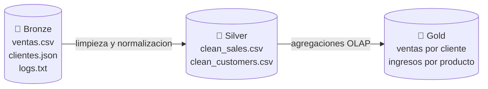

# 🏛️ Datacycle Mini Lakehouse


Practica **Activity 3 – Building a Mini Lakehouse** (Datacycle · Unidad 2 · curso 2026-27).
Pipeline de datos con arquitectura medallion: **Bronze → Silver → Gold**.



## 👥 Equipo

| Persona | Capa | Responsabilidad |
|---|---|---|
| [@Ignaciobrenas](https://github.com/Ignaciobrenas) | 🥉 Bronze | Analisis de datos crudos, estructura del repo |
| [@MauroPB30](https://github.com/MauroPB30) | 🥈 Silver | Limpieza, normalizacion, datasets limpios |
| [@gorkarmz](https://github.com/gorkarmz) | 🥇 Gold | Analitica, informe final, README |

## 📁 Estructura

```
data_lab/
├── bronze/   # datos crudos (ventas.csv, clientes.json, logs.txt)
├── silver/   # clean_sales.csv, clean_customers.csv
└── gold/     # tablas analiticas finales
src/          # scripts Python (bronze_analysis, silver_clean, gold_analytics)
docs/         # informes y evidencia de uso de IA
```

## 🔗 Contrato Silver

- `clean_sales.csv`: `id_pedido,id_cliente,producto,importe`
- `clean_customers.csv`: `id_cliente,nombre,pais`

## 🚀 Como ejecutar

```bash
pip install -r requirements.txt
python src/silver_clean.py
python src/gold_analytics.py
```

## 🤝 Flujo de trabajo

1. Coge un [issue](../../issues) de tu capa (etiquetas `bronze` / `silver` / `gold`).
2. Rama: `feat/<capa>-<tema>` → Pull Request a `main`, revisado por otro companero.
3. Solo edita los archivos de tu capa para evitar conflictos. Mas detalle en [PLAN.md](PLAN.md).
