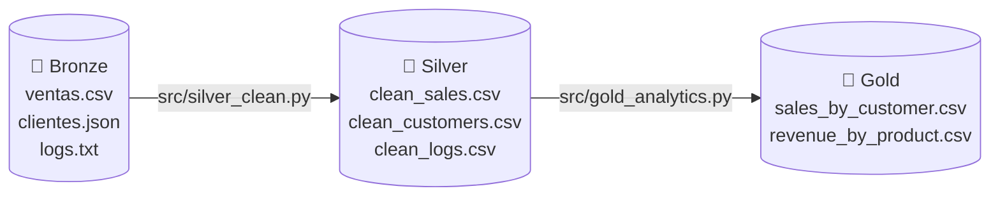

# 🏛️ Datacycle Mini Lakehouse


Práctica **Activity 3 – Building a Mini Lakehouse** (Datacycle · Unidad 2 · Curso 2026-27).
Pipeline automatizado de ingeniería de datos con arquitectura Medallion: **Bronze → Silver → Gold**.



## 👥 Equipo

| Integrante | Capas / Issues | Responsabilidad |
|---|---|---|
| [@Ignaciobrenas](https://github.com/Ignaciobrenas) | 🥉 Bronze (#1, #2) · 🥈 Silver (#3) · 📄 Docs (#7) | Análisis de datos crudos, arquitectura común, limpieza de ventas e informe final |
| [@gorkarmz](https://github.com/gorkarmz) | 🥈 Silver (#4) · 📄 Docs (#7) | Limpieza y normalización de clientes y logs (`clean_customers.csv`, `clean_logs.csv`) |
| [@MauroPB30](https://github.com/MauroPB30) | 🥇 Gold (#5, #6) · 📄 Docs (#7) | Analítica OLAP (`sales_by_customer.csv`, `revenue_by_product.csv`) e informe Gold |

## 📁 Estructura del Repositorio

```text
datacycle-mini-lakehouse/
├── data_lab/
│   ├── bronze/                 # Datos crudos inmutables del ZIP
│   │   ├── ventas.csv          # 200 pedidos (218 líneas, 17 en blanco)
│   │   ├── clientes.json       # 250 clientes (274 líneas, 22 en blanco)
│   │   └── logs.txt            # 205 eventos (207 líneas, 2 en blanco)
│   ├── silver/                 # Datasets limpios y normalizados
│   │   ├── clean_customers.csv # 248 clientes válidos tipados
│   │   ├── clean_logs.csv      # 162 eventos válidos (INFO/WARN)
│   │   └── clean_sales.csv     # 192 ventas válidas verificadas
│   └── gold/                   # Tablas analíticas de negocio
│       ├── sales_by_customer.csv  # 189 clientes con compras (192 pedidos)
│       └── revenue_by_product.csv # 3 productos (Total revenue: 16415.00)
├── src/
│   ├── common.py               # Rutas portables (pathlib.Path) y verificación de carpetas
│   ├── bronze_analysis.py      # Diagnóstico automatizado de anomalías en Bronze
│   ├── silver_clean.py         # Pipeline de limpieza y normalización Bronze -> Silver
│   └── gold_analytics.py       # Agregaciones de negocio Silver -> Gold
├── docs/
│   ├── bronze_report.md        # Informe detallado de la capa Bronze (Parte 1)
│   ├── gold_report.md          # Informe analítico de la capa Gold (Parte 3)
│   ├── final_report.md         # Informe final consolidado (Partes 1, 2 y 3 + preguntas PDF)
│   └── ai_usage.md             # Evidencia de uso de IA (herramientas, prompts y salidas)
├── PLAN.md                     # Planificación del equipo y contrato entre capas
└── requirements.txt            # Dependencias del proyecto (pandas)
```

> **Nota sobre nombres de ficheros:** el enunciado en PDF menciona `sales.csv` y `customers.json`, pero el dataset entregado en el ZIP viene como `ventas.csv` y `clientes.json` (junto con `logs.txt`). El pipeline opera directamente sobre los ficheros entregados.

## 🔗 Contrato de Datos (Silver y Gold)

### Capa Silver (`data_lab/silver/`)
- **`clean_customers.csv`**: `id_cliente,nombre,pais` (`id_cliente` entero positivo; valores vacíos, `null` o `"??"` normalizados a `desconocido`; países en mayúsculas; excluidas cuentas sintéticas `200 TestUser` y `201 Debug`).
- **`clean_logs.csv`**: `nivel,id_cliente,action` (solo eventos `INFO` y `WARN` bien formados de clientes válidos; excluidos `[ERROR]`, `[DEBUG]`, líneas vacías o sin `user`/`action`, sin eliminar de `clean_customers.csv` a los clientes reales con errores en logs).
- **`clean_sales.csv`**: `id_pedido,id_cliente,producto,importe` (`id_pedido` e `id_cliente` enteros válidos con integridad referencial; `producto` en minúsculas excluyendo `test`; `importe` float `> 0` excluyendo `-10`, `abc`, `0` y el outlier `9999` de `Debug`).

### Capa Gold (`data_lab/gold/`)
- **`sales_by_customer.csv`**: `id_cliente,nombre,pais,num_pedidos,total_sales` (agrupado por `id_cliente` para no mezclar homónimos como `101 Ana` y `111 Ana`, ordenado por `total_sales` descendente).
- **`revenue_by_product.csv`**: `producto,num_pedidos,total_revenue` (ordenado por `total_revenue` descendente).

## 📊 Resultados Principales

- **Ingreso total global (`Total revenue`):** **`16415.00`** (192 pedidos válidos).
- **Mayor comprador por gasto total:** **Pedro** (`id_cliente=106`, `PT`) con **`300.00`** (1 pedido).
- **Mayor compradora por número de pedidos:** **Ana** (`id_cliente=101`, `ES`) con **4 pedidos** y **`290.00`** (`111 Ana` se mantiene separada con 1 pedido y `30.00`).
- **Producto que genera más ingresos:** **`monitor`** con **`13190.00`** (64 pedidos, **80,35 %** del total), seguido de `teclado` (`1980.00`, 66 pedidos) y `raton` (`1245.00`, 62 pedidos).

## 🚀 Cómo Ejecutar el Pipeline Completo

Desde la raíz del repositorio:

```bash
# 1. Instalar dependencias
pip install -r requirements.txt

# 2. Parte 1 (Bronze): análisis exploratorio de datos crudos
python src/bronze_analysis.py

# 3. Parte 2 (Silver): limpieza y generación de data_lab/silver/*.csv
python src/silver_clean.py

# 4. Parte 3 (Gold): analítica y generación de data_lab/gold/*.csv
python src/gold_analytics.py
```

También pueden ejecutarse como módulos de Python (`python -m src.bronze_analysis`, `python -m src.silver_clean`, `python -m src.gold_analytics`).

## 📚 Documentación y Entregables

- **[Informe Final Consolidado (`docs/final_report.md`)](docs/final_report.md)**: respuestas completas a todas las preguntas del PDF (Generales, Bronze, Silver y Gold).
- **[Informe Capa Bronze (`docs/bronze_report.md`)](docs/bronze_report.md)**: auditoría detallada de `ventas.csv`, `clientes.json` y `logs.txt`.
- **[Informe Capa Gold (`docs/gold_report.md`)](docs/gold_report.md)**: análisis de ingresos por cliente y por producto.
- **[Evidencia de Uso de IA (`docs/ai_usage.md`)](docs/ai_usage.md)**: registro de herramientas, modelos, prompts y salidas empleadas.
