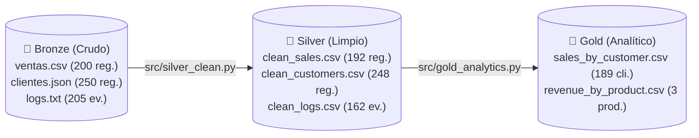

# Informe Final — Activity 3: Building a Mini Lakehouse

Informe global del proyecto **Datacycle (Unidad 2 · Curso 2026-27)** que consolida el análisis exploratorio de la capa **Bronze**, las reglas de limpieza y normalización de la capa **Silver**, y los resultados analíticos de negocio de la capa **Gold**.

> **Nota sobre nombres de ficheros (PDF vs. ZIP entregado):** el enunciado en PDF menciona `sales.csv` y `customers.json`, mientras que el paquete de datos original contiene `ventas.csv`, `clientes.json` y `logs.txt`. Todo el pipeline procesa directamente los ficheros reales entregados en `data_lab/bronze/` sin edición manual.

---

## 1. Arquitectura del Pipeline (Medallion)

| Capa | Script responsable | Entradas | Salidas | Informe específico |
|---|---|---|---|---|
| **Común** | [`src/common.py`](../src/common.py) | Estructura del repositorio | Resolución portable de rutas (`pathlib.Path`) | — |
| **🥉 Bronze** | [`src/bronze_analysis.py`](../src/bronze_analysis.py) | `data_lab/bronze/{ventas.csv, clientes.json, logs.txt}` | Diagnóstico en consola e inventario de anomalías | [`docs/bronze_report.md`](bronze_report.md) |
| **🥈 Silver** | [`src/silver_clean.py`](../src/silver_clean.py) | `data_lab/bronze/*` | `data_lab/silver/{clean_customers, clean_logs, clean_sales}.csv` | Sección 4 de este informe |
| **🥇 Gold** | [`src/gold_analytics.py`](../src/gold_analytics.py) | `data_lab/silver/{clean_sales, clean_customers}.csv` | `data_lab/gold/{sales_by_customer, revenue_by_product}.csv` | [`docs/gold_report.md`](gold_report.md) |

---

## 2. Respuestas Directas a las Preguntas del Enunciado (PDF)

### 2.1 ¿Qué registros son inválidos?
- **En `ventas.csv` (8 pedidos descartados de 200):**
  1. `id_pedido=5` (línea 6): `id_cliente=999` inexistente en `clientes.json` (huérfano).
  2. `id_pedido=6` (línea 7): `importe=-10` (valor negativo inválido).
  3. `id_pedido=7` (línea 8): `importe=abc` (texto no numérico).
  4. `id_pedido=15` (línea 16): `id_cliente=""` (identificador de cliente vacío).
  5. `id_pedido=29` (línea 30): `id_cliente=200`, `producto=test`, `importe=0` (registro de prueba con importe cero).
  6. `id_pedido=30` (línea 31): `id_cliente=201`, `producto=monitor`, `importe=9999` (outlier artificial de la cuenta `Debug`).
  7. `id_pedido=107` (línea 116): `id_cliente=200` (`TestUser`, cuenta sintética de prueba).
  8. `id_pedido=108` (línea 117): `id_cliente=201` (`Debug`, cuenta sintética de depuración).
- **En `clientes.json` (2 cuentas descartadas + 4 registros con anomalías recuperables):**
  - Cuentas no productivas descartadas: `id_cliente=200` (`TestUser`, `pais="??"`) e `id_cliente=201` (`Debug`, `pais="ES"`).
  - Registros recuperables normalizados en Silver: `id_cliente="120"` (`Eva`, ID como string), `id_cliente=112` (`nombre=""`), `id_cliente=117` (`pais=null`) e `id_cliente=138` (`pais="??"`).
- **En `logs.txt` (45 líneas descartadas de 207):**
  - **2** líneas en blanco (`155`, `186`).
  - **35** eventos `[ERROR]` (incluyendo usuarios no numéricos `user=abc` en línea 15 y `user=xyz` en línea 124, y el usuario huérfano `user=999` en líneas 4 y 27).
  - **4** eventos `[DEBUG]` con `action=test` (líneas `25, 105, 106, 107`).
  - **1** línea sin campo `user=` (línea `22`: `[INFO] action=compra`).
  - **2** líneas con `action=` vacío (líneas `23` y `117`).
  - **1** evento asociado a cuenta de prueba (`user=200` en línea `104`).

### 2.2 ¿Qué clientes tienen información faltante o incompleta?
| `id_cliente` | `nombre` (Bronze) | `pais` (Bronze) | Problema detectado | Tratamiento en Silver (`clean_customers.csv`) |
|---:|---|---|---|---|
| `112` | `""` (vacío) | `"ES"` | Falta el nombre del cliente | Normalizado a `112,desconocido,ES` |
| `117` | `"Raul"` | `null` | Falta el país (`null`) | Normalizado a `117,Raul,desconocido` |
| `138` | `"user8"` | `"??"` | País con marcador desconocido (`"??"`) | Normalizado a `138,user8,desconocido` |
| `200` | `"TestUser"` | `"??"` | Cuenta sintética de prueba y país `"??"` | Excluido de Silver y Gold |
| `120` | `"Eva"` | `"ES"` | Contenido completo, pero `id_cliente` tipado como `string` (`"120"`) | Convertido a entero `120,Eva,ES` |

### 2.3 ¿Quién es el mayor comprador / qué cliente genera más ingresos?
- **Mayor comprador por ingresos totales (gasto):** **Pedro** (`id_cliente=106`, `pais=PT`), con **`300.00`** en 1 pedido (`id_pedido=8`, `monitor`).
- **Mayor comprador por número de pedidos:** **Ana** (`id_cliente=101`, `pais=ES`), con **4 pedidos** (`id_pedido=1, 3, 31, 32`) y un gasto acumulado de **`290.00`**.
- **Por qué es crítico agrupar por `id_cliente` y limpiar Silver:**
  1. Existen dos clientas distintas llamadas `Ana`: `id_cliente=101` (`290.00` en 4 pedidos) e `id_cliente=111` (`30.00` en 1 pedido). Si se agrupara erróneamente por `nombre`, `Ana` sumaría `320.00` y superaría falsamente a Pedro (`300.00`).
  2. Si no se filtrara en Silver el pedido `30` de la cuenta sintética `201 Debug` (`importe=9999`), `Debug` aparecería artificialmente como mayor comprador.

### 2.4 ¿Qué producto genera más ingresos?
- **`monitor`** es el producto que genera más ingresos con **`13190.00`** (**80,35 %** del ingreso total global de **`16415.00`**) a lo largo de **64 pedidos**, seguido de `teclado` (`1980.00` en 66 pedidos) y `raton` (`1245.00` en 62 pedidos).

---

## 3. Parte 1 — Análisis de la Capa Bronze

El detalle exhaustivo línea por línea se encuentra en [`docs/bronze_report.md`](bronze_report.md).

### 3.1 Estructura de los ficheros crudos
| Fichero | Tipo / Formato | Tamaño | Líneas totales | Registros | Líneas en blanco | Esquema / Campos |
|---|---|---:|---:|---:|---:|---|
| `data_lab/bronze/ventas.csv` | CSV (tabular delimitado por comas) | 3.897 B | 218 | 200 pedidos | 17 | `id_pedido,id_cliente,producto,importe` |
| `data_lab/bronze/clientes.json` | JSON (array de objetos) | 12.599 B | 274 | 250 clientes | 22 | `id_cliente`, `nombre`, `pais` |
| `data_lab/bronze/logs.txt` | Texto plano (clave=valor con nivel) | 6.109 B | 207 | 205 eventos | 2 | `[NIVEL] user=<id> action=<accion>` |

### 3.2 Síntesis de fiabilidad e información faltante en Bronze
- **Datos no fiables:** importes negativos (`-10`), alfanuméricos (`abc`), nulos de prueba (`0` en `producto=test`), outlier artificial (`9999` de `201 Debug`), ventas sin cliente válido (`id_pedido=15` vacío e `id_pedido=5` con `id_cliente=999`), eventos `[ERROR]`/`[DEBUG]` en logs y marcadores `"??"` en países.
- **Información faltante a nivel de registro:** `id_cliente` en pedido `15`; `nombre` en cliente `112`; `pais` en clientes `117` (`null`), `138` (`"??"`) y `200` (`"??"`); campo `user=` en línea `22` de logs y valor de `action=` en líneas `23` y `117` de logs.
- **Información faltante a nivel de modelo:** ausencia de marcas temporales (`timestamp`) en ventas y logs, y ausencia de cantidad de unidades o catálogo maestro de productos.

---

## 4. Parte 2 — Limpieza y Normalización en la Capa Silver

Implementada de forma 100 % automática en [`src/silver_clean.py`](../src/silver_clean.py), ejecutando en orden `clean_customers()` $\rightarrow$ `clean_logs()` $\rightarrow$ `clean_sales()` para garantizar la integridad referencial contra el maestro limpio de clientes.

### 4.1 Reglas aplicadas y balance de registros

| Dataset Silver | Esquema exportado | Entrada (Bronze) | Descartados | Salida (Silver) | Reglas de limpieza y normalización |
|---|---|---:|---:|---:|---|
| [`clean_customers.csv`](../data_lab/silver/clean_customers.csv) | `id_cliente,nombre,pais` | 250 clientes (274 líneas) | 2 (`200 TestUser`, `201 Debug`) | **248 clientes** | • Ignora 22 líneas vacías. • Convierte `id_cliente` a `int > 0` (`"120"` $\rightarrow$ `120`). • Sustituye `nombre` vacío (`112`) y `pais` `null`/`"??"` (`117, 138`) por `"desconocido"`. • Normaliza países válidos en mayúsculas (`ES, FR, IT, PT, DE, UK`). • Deduplica por `id_cliente` (preservando homónimos `101 Ana` y `111 Ana`). |
| [`clean_logs.csv`](../data_lab/silver/clean_logs.csv) | `nivel,id_cliente,action` | 205 eventos (207 líneas) | 45 líneas | **162 eventos** | • Descarta 2 líneas en blanco, 35 `[ERROR]` y 4 `[DEBUG]`. • Descarta líneas sin `user=` (1), con `action=` vacío (2) o de usuarios inexistentes/test (`999, abc, xyz, 200`). • Estandariza `user` a `id_cliente` (`int`) y `action` en minúsculas. • **No elimina** de `clean_customers.csv` a los 31 clientes reales que tuvieron algún `[ERROR]` en logs. |
| [`clean_sales.csv`](../data_lab/silver/clean_sales.csv) | `id_pedido,id_cliente,producto,importe` | 200 pedidos (218 líneas) | 8 pedidos (`5, 6, 7, 15, 29, 30, 107, 108`) | **192 pedidos** | • Ignora 17 líneas en blanco. • Exige `id_pedido` e `id_cliente` `int > 0` y que `id_cliente` exista en `clean_customers.csv`. • Filtra producto `"test"` e importes no numéricos, `<= 0` o `> 1000.0` (`9999`). • Normaliza `producto` en minúsculas e `importe` a `float` (2 decimales). • Conserva pedidos `1, 31, 32` al tener distinto `id_pedido`. |

---

## 5. Parte 3 — Analítica en la Capa Gold

Implementada en [`src/gold_analytics.py`](../src/gold_analytics.py) y detallada en [`docs/gold_report.md`](gold_report.md). Lee **exclusivamente** de `data_lab/silver/`.

### 5.1 Ventas por cliente (`data_lab/gold/sales_by_customer.csv`)
Se realiza un `inner join` entre `clean_sales.csv` y `clean_customers.csv` por `id_cliente`, agrupando por `(id_cliente, nombre, pais)` y ordenando por `total_sales` descendente (**189 clientes con compras**, sumando **192 pedidos**):

| Posición | `id_cliente` | `nombre` | `pais` | `num_pedidos` | `total_sales` | Observación |
|---:|---:|---|---:|---:|---:|---|
| **1º (Gasto)** | `106` | **Pedro** | `PT` | 1 | **`300.00`** | Mayor comprador por ingresos generados |
| **2º (1ª en pedidos)** | `101` | **Ana** | `ES` | **4** | **`290.00`** | Mayor compradora por frecuencia (pedidos `1, 3, 31, 32`) |
| 3º | `109` | Elena | `FR` | 1 | `220.00` | Compra de `monitor` |
| 4º | `112` | desconocido | `ES` | 1 | `210.00` | Cliente con nombre vacío normalizado en Silver |
| 5º | `120` | Eva | `ES` | 1 | `210.00` | Cliente con ID `"120"` normalizado a entero en Silver |
| ... | ... | ... | ... | ... | ... | *(30 clientes empatados a `210.00` y 29 a `200.00`)* |
| 94º | `111` | **Ana** | `ES` | 1 | `30.00` | Homónima de `101 Ana`, mantenida independiente por ID |

### 5.2 Ingresos por producto (`data_lab/gold/revenue_by_product.csv`)

| `producto` | `num_pedidos` | `total_revenue` | % sobre Total Revenue | Ticket medio |
|---|---:|---:|---:|---:|
| **`monitor`** | 64 | **`13190.00`** | **80,35 %** | `206.09` |
| **`teclado`** | 66 | **`1980.00`** | **12,06 %** | `30.00` |
| **`raton`** | 62 | **`1245.00`** | **7,58 %** | `20.08` |
| **TOTAL GLOBAL** | **192** | **`16415.00`** | **100,00 %** | **`85.49`** |

> **Verificación de consistencia:** la suma de `total_sales` en `sales_by_customer.csv` (`16415.00`) coincide exactamente con la suma de `total_revenue` en `revenue_by_product.csv` (`16415.00`), confirmando que ninguna venta limpia quedó huérfana ni duplicada en el cruce con clientes.

---

## 6. Cumplimiento de Requisitos de Entrega ("IMPORTANT NOTE" del PDF)

1. **Procesamiento 100 % automático:** ningún archivo CSV/JSON/TXT ha sido editado a mano; `src/silver_clean.py` y `src/gold_analytics.py` regeneran de forma determinista todos los ficheros de `data_lab/silver/` y `data_lab/gold/`.
2. **Código Python comentado explicando la lógica:** todos los scripts dentro de `src/` incluyen docstrings y comentarios explicativos de cada regla de validación, limpieza y agregación.
3. **Trazabilidad de IA:** todas las herramientas de IA empleadas, los prompts y las salidas obtenidas por los integrantes del equipo están documentados en [`docs/ai_usage.md`](ai_usage.md).
